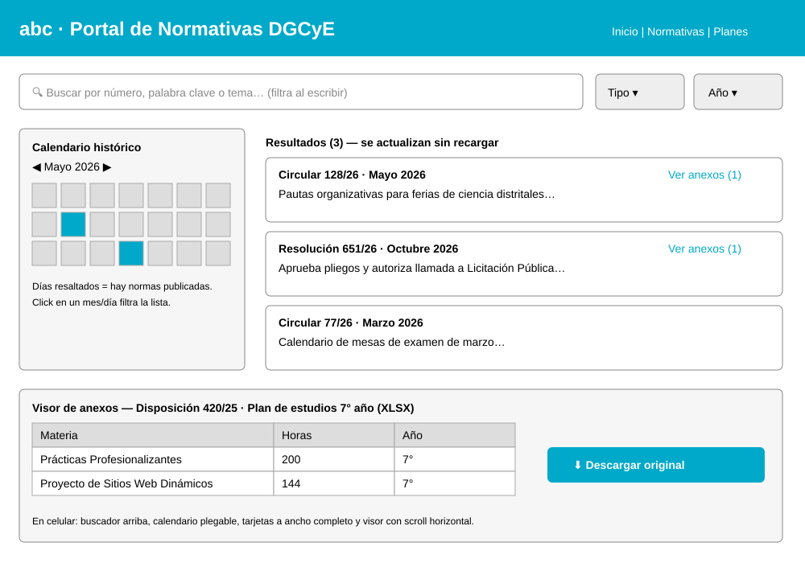

# Documento de Especificación de Requerimientos (SRS) — Portal de Normativas DGCyE

**Materia:** Proyecto de Implementación de Sitios Web Dinámicos — 7° 2° Grupo B
**Escuela:** EEST N.º 1 "Eduardo Ader", Vicente López
**Profesor:** Mansilla Muñoz, York Elías
**Integrantes:** Oviedo, Alex
**Fecha:** 5 de noviembre de 2026

---

## 1. Minuta de entrevista

**Cliente:** Directores de área de la Dirección General de Cultura y Educación de la Provincia de Buenos Aires (DGCyE).
**Tema:** Portal web para buscar y consultar normativas del nivel secundario técnico en los 135 distritos.

1. Inspectores, directores de escuelas técnicas y docentes pierden horas buscando resoluciones, circulares y planes de estudio dentro de PDFs desordenados.
2. Piden un buscador por palabras clave que muestre los resultados al instante, sin recargar la página.
3. Quieren un calendario histórico para ubicar las normas por año y mes, y poder filtrar por tipo (Resolución, Disposición, Circular).
4. Necesitan un panel para ver rápido los anexos (PDF y planillas Excel de planes de estudio) y descargarlos.
5. El sistema tiene que andar fluido tanto en las computadoras del Estado como en los celulares de los docentes.

La guía de la entrevista se basó en el portal oficial ABC (Dirección General de Cultura y Educación, s.f.).

---

## 2. Requerimientos

### A. Requerimientos funcionales (lo que el sistema DEBE hacer)

| ID | Requerimiento | Criterio de aceptación |
|----|---------------|------------------------|
| RF1 | **Búsqueda dinámica en tiempo real.** El usuario escribe en una barra de búsqueda y la lista de normativas se filtra al instante, sin recargar la página. | Al escribir "feria" se ve solo la Circular 128/26. La búsqueda ignora mayúsculas y tildes y busca en número, tipo y descripción. |
| RF2 | **Filtro por categorías y calendario.** Filtrar por año y por mes con un calendario interactivo, y por tipo de norma (Resolución, Disposición, Circular). | Los filtros se combinan con el texto buscado. El calendario resalta los meses o días que tienen normas. |
| RF3 | **Visor de anexos y enlaces.** Cada norma muestra sus documentos asociados (PDF o planillas). Las planillas se ven como tabla y todos se pueden descargar. | Un .xlsx se muestra como tabla HTML (con SheetJS) y el botón "Descargar" baja el archivo original. |
| RF4 | **Detalle de la norma.** Al elegir un resultado se ven el número, el tipo, la fecha, el distrito y la descripción completa. | El detalle abre sin recargar la página. |
| RF5 | **Sin resultados.** Si ningún resultado coincide, se muestra un mensaje claro y la opción de limpiar los filtros. | El botón "Limpiar filtros" vuelve a mostrar el listado completo. |

### B. Requerimientos no funcionales (cómo debe comportarse el sistema)

| ID | Requerimiento | Cómo se verifica |
|----|---------------|------------------|
| RNF1 | **Rendimiento.** El filtrado se hace del lado del cliente, en memoria con JavaScript (`Array.prototype.filter`), en menos de 100 ms, para mantener 60 fps. | Se mide con `performance.now()` antes y después de filtrar. |
| RNF2 | **Compatibilidad y responsividad.** La interfaz se adapta a celulares (desde 360 px) y a escritorios de 1080p. | Se prueba con las herramientas de desarrollador en Chrome y Firefox, en 360 px, 768 px y 1920 px. |
| RNF3 | **Seguridad y despliegue.** El despliegue es automático en la nube (Vercel o Render) con CI/CD conectado a GitHub y HTTPS. | Cada push a `main` genera un despliegue nuevo con URL `https://`. |
| RNF4 | **Accesibilidad.** Los campos tienen etiquetas, el sitio se puede usar con teclado y el contraste es suficiente. | Se revisa con Lighthouse (puntaje de accesibilidad de 90 o más). |
| RNF5 | **Mantenibilidad.** Los datos están separados de la lógica (`js/datos.js`), así después se pueden reemplazar por un JSON cargado con `fetch()`. | Para cambiar la fuente de datos no hace falta tocar la interfaz. |

### C. Modelo de datos inicial (estructura JSON simulada)

Archivo completo: [`js/datos.js`](../js/datos.js) (8 normativas simuladas, para pruebas).

```js
const normativasDGCyE = [
  {
    id: 1,
    nro: "651/26",
    tipo: "Resolución",          // "Resolución" | "Disposición" | "Circular"
    anio: 2026,
    mes: "Octubre",
    distrito: "Provincial",      // o uno de los 135 distritos
    desc: "Aprueba pliegos y autoriza llamada a Licitación Pública para talleres de EEST.",
    anexos: [
      { nombre: "Pliego de bases y condiciones", formato: "PDF", url: "anexos/651-26-pliego.pdf" }
    ]
  },
  // ...
];
```

Ejemplo de uso (búsqueda combinada para RF1 y RF2):

```js
filtrar({ texto: "feria", tipo: "Circular", anio: 2026 }); // → [Circular 128/26]
```

---

## 3. Mockup inicial

Boceto digital de la pantalla principal, inspirado en el portal ABC:



- **Arriba:** un buscador que filtra mientras se escribe, junto a los desplegables de Tipo y Año.
- **Izquierda:** un calendario histórico; los días resaltados tienen normas publicadas.
- **Centro:** tarjetas con los resultados (número, tipo, fecha, descripción y "Ver anexos").
- **Abajo:** un visor de anexos que muestra la planilla como tabla y tiene el botón "Descargar original".
- **En el celular:** todo queda en una sola columna y el calendario se puede plegar.

---

## Referencias

Dirección General de Cultura y Educación. (s.f.). *Portal ABC*. Gobierno de la Provincia de Buenos Aires. https://abc.gob.ar

MDN contributors. (s.f.-a). *Array.prototype.filter()*. MDN Web Docs. https://developer.mozilla.org/es/docs/Web/JavaScript/Reference/Global_Objects/Array/filter

MDN contributors. (s.f.-b). *Fetch API*. MDN Web Docs. https://developer.mozilla.org/es/docs/Web/API/Fetch_API

SheetJS LLC. (s.f.). *SheetJS Community Edition documentation*. https://docs.sheetjs.com
